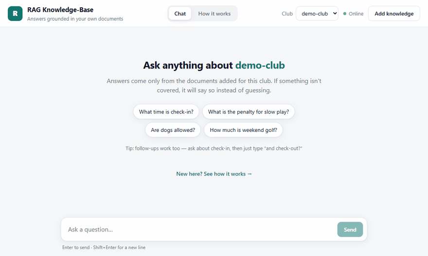
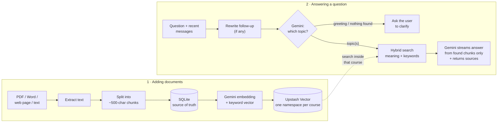
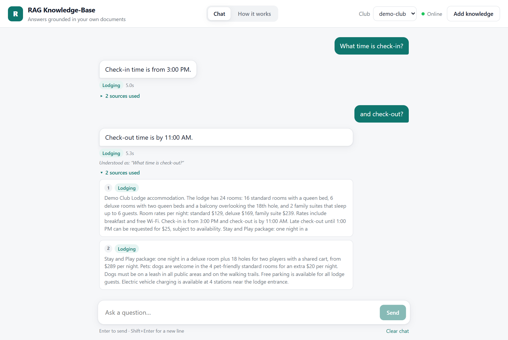
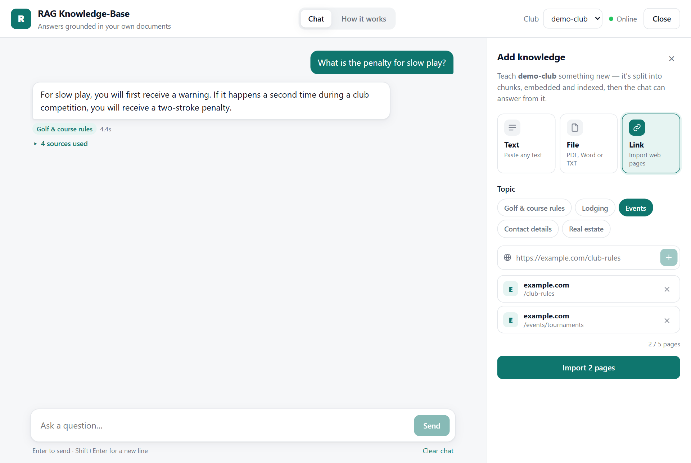
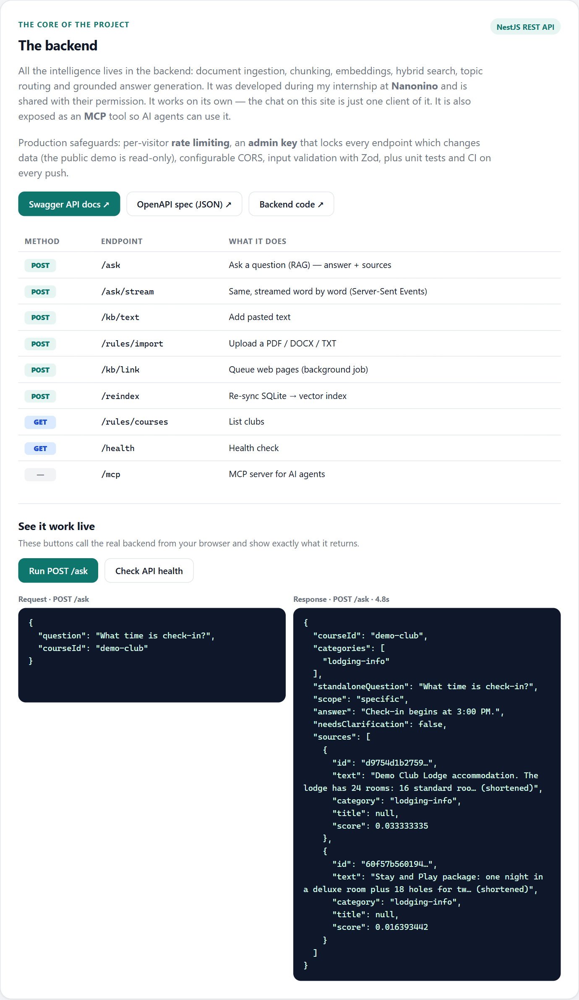
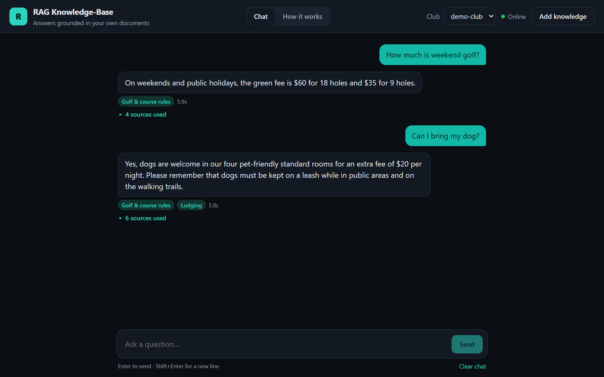
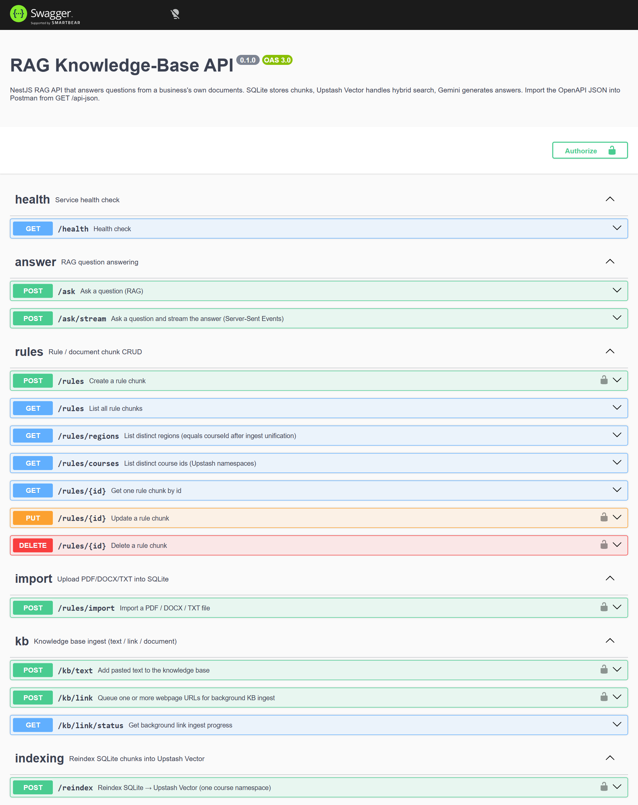

# RAG Knowledge-Base (NestJS + React)

[](https://github.com/josephamal10/rag-knowledge-base-api/actions/workflows/ci.yml)


A full-stack AI assistant that answers questions using **only** a business's own documents — rules, prices,
rooms, events and contact details — and says so honestly when something isn't covered.
Upload PDFs, Word files, web pages or plain text; ask a question; get a streamed answer with the sources it came from.

**🔗 Live demo:** [rag-knowledge-base-gray.vercel.app](https://rag-knowledge-base-gray.vercel.app) · **API docs:** [Swagger](https://rag-knowledge-base-api-b0hp.onrender.com/api)
<sub>The API runs on a free Render instance that sleeps when idle — the first question after a quiet spell can take up to a minute.</sub>

- **Backend** (`/src`) — NestJS RAG API, built during my internship at **Nanonino** and shared with their permission. Client data, keys and client-specific code have been removed.
- **Frontend** (`/frontend`) — React chat interface, added afterwards.



## Features

- **Grounded answers with citations** — every answer lists the document chunks it was based on; no made-up answers.
- **Hybrid search** — semantic (Gemini embeddings) + keyword (sparse vectors) search in Upstash Vector, fused with Reciprocal Rank Fusion.
- **Topic routing** — an LLM classifier picks the relevant topic(s) before searching; vague questions fall back to searching everything.
- **Follow-up questions** — "and check-out?" is rewritten into a standalone question using the recent conversation.
- **Streaming** — answers arrive word by word over Server-Sent Events (`POST /ask/stream`).
- **Multi-tenant** — each club (`courseId`) is an isolated Upstash namespace.
- **Ingestion** — PDF, Word (.docx), TXT, web pages (background job with retries) or pasted text.
- **Production safeguards** — per-IP rate limiting, admin key for every write endpoint, configurable CORS, Zod validation.
- **MCP server** — the same Q&A is exposed as a Model Context Protocol tool for AI agents.
- **Tested & containerised** — Jest + Vitest unit tests, GitHub Actions CI, Docker Compose for one-command start.

## How it works



1. **Ingest** — text is extracted (pdf-parse, mammoth, Readability), split into ~500-character chunks on word boundaries, and saved to SQLite (the source of truth).
2. **Index** — each chunk gets a dense Gemini embedding plus a sparse keyword vector, stored in an Upstash Vector **hybrid** index under a content-hash id (re-indexing never re-embeds unchanged text).
3. **Understand** — if recent messages are sent, a follow-up is rewritten into a standalone question.
4. **Route** — Gemini classifies the question into topics (`golf-rules`, `lodging-info`, `events-info`, `contact-info`, `real-estate-info`) using a description of each.
5. **Retrieve** — hybrid search (semantic + keyword, RRF) inside the course namespace, filtered by topic.
6. **Answer** — Gemini answers using only the retrieved chunks (or replies `NO_ANSWER`, which becomes an honest "I don't have information"). The answer streams to the client, followed by its sources.

## Screenshots

**Chat** — streamed answers, topic tags, a follow-up understood from context, and the sources used:



**Add knowledge** — paste text, drag in a PDF / Word / TXT file, or import web pages by link (with live progress); it's chunked, embedded and indexed straight away:



**How it works page** — plain-language explanation for visitors, Swagger / OpenAPI links, and a live API call showing the raw request and response:



**Dark mode:**



**API** — interactive Swagger UI at `/api` (with an **Authorize** button for the admin key):



## Tech stack

| Piece | Role |
|---|---|
| **NestJS / TypeScript** | REST API, SSE streaming, guards, rate limiting (`@nestjs/throttler`) |
| **SQLite + TypeORM** | Stores chunks, course id, category, titles |
| **Upstash Vector (Hybrid)** | Dense + sparse search, one namespace per course |
| **Google Gemini** | `gemini-embedding-001` embeddings; flash-lite model for routing, follow-up rewriting and answers |
| **pdf-parse, mammoth, @mozilla/readability, jsdom** | Text extraction from PDF, DOCX and web pages |
| **Model Context Protocol (MCP)** | Exposes the Q&A as a tool for AI clients (stdio + Streamable HTTP) |
| **Swagger / OpenAPI** | Interactive API docs at `/api` |
| **Zod** | Request and environment validation |
| **React 19 + Vite + TypeScript** | Chat frontend (`/frontend`), plain CSS with light/dark mode |
| **Jest, Vitest, GitHub Actions** | Unit tests and CI |
| **Docker + nginx** | Containers and one-command local start |

## Quick start

### 1. Create an Upstash Vector index

In the [Upstash console](https://console.upstash.com), create a **Vector** index: **Type** Hybrid · **Dense dimension** `1536` · **Similarity** Cosine · **Embedding model** none (the app sends its own embeddings and sparse vectors). Copy the REST URL and token.

### 2. Configure environment

```bash
cp .env.example .env
```

Fill in `GEMINI_API_KEY`, `UPSTASH_VECTOR_REST_URL` and `UPSTASH_VECTOR_REST_TOKEN`.

### 3a. Run with Docker (one command)

```bash
docker compose up --build
```

Frontend: `http://localhost:8080` · API + Swagger: `http://localhost:3000/api`. The fictional demo club is loaded automatically on first start.

### 3b. Or run locally

```bash
npm install
npm run seed        # load the fictional "demo-club" knowledge base (all five topics)
npm run start:dev   # API on http://localhost:3000, Swagger at /api
```

In a second terminal:

```bash
cd frontend
npm install
npm run dev         # http://localhost:5173
```

See [frontend/README.md](frontend/README.md) for frontend configuration.

## API usage

`courseId` (lowercase `a-z0-9_-`) and `category` are required on ingest. Imported files are deleted after a successful import.

```bash
# Ask a question — returns the answer plus the source chunks it used
curl -X POST http://localhost:3000/ask \
  -H "Content-Type: application/json" \
  -d '{"question":"What time is check-in?","courseId":"demo-club"}'

# Follow-up: send recent turns as history
curl -X POST http://localhost:3000/ask \
  -H "Content-Type: application/json" \
  -d '{"question":"and check-out?","courseId":"demo-club","history":[{"role":"user","content":"What time is check-in?"},{"role":"assistant","content":"From 3:00 PM."}]}'

# Streamed answer (Server-Sent Events: meta → delta… → done)
curl -N -X POST http://localhost:3000/ask/stream \
  -H "Content-Type: application/json" \
  -d '{"question":"How much is weekend golf?","courseId":"demo-club"}'

# Import a document
curl -X POST http://localhost:3000/rules/import \
  -F "courseId=demo-club" -F "category=golf-rules" -F "file=@path/to/rules.pdf"

# Add pasted text
curl -X POST http://localhost:3000/kb/text \
  -H "Content-Type: application/json" \
  -d '{"text":"Carts must stay on paths when the course is wet.","courseId":"demo-club","category":"golf-rules"}'

# Queue web pages (background job; poll GET /kb/link/status)
curl -X POST http://localhost:3000/kb/link \
  -H "Content-Type: application/json" \
  -d '{"urls":["https://example.com/club-rules"],"courseId":"demo-club","category":"golf-rules"}'

# Rebuild one course's vectors from SQLite
curl -X POST http://localhost:3000/reindex \
  -H "Content-Type: application/json" -d '{"courseId":"demo-club"}'
```

Other endpoints: `GET/POST/PUT/DELETE /rules`, `GET /rules/courses`, `GET /health`.

### Security settings (for a public deployment)

| Variable | Effect |
|---|---|
| `ADMIN_API_KEY` | When set, every endpoint that changes data requires the `x-admin-key` header. Asking questions stays public. |
| `RATE_LIMIT_PER_MINUTE` | Requests per client IP per minute, per endpoint (default 30). `/health` is exempt. |
| `CORS_ORIGIN` | Comma-separated frontend origins allowed to call the API (unset = allow all). |
| `TRUST_PROXY` | `true` behind a reverse proxy (Render, nginx) so rate limiting sees the real client IP. |

## Testing

```bash
npm test                    # backend: Jest (answer pipeline, streaming, chunking, sparse vectors, guards…)
cd frontend && npm test     # frontend: Vitest (streaming parser)
```

The answer pipeline is tested with Gemini and the vector store mocked, so tests run in seconds without API keys. GitHub Actions runs type-checks, lint, tests and builds for both apps on every push.

## Deployment

The backend deploys to **Render** ([`render.yaml`](render.yaml)) and the frontend to **Vercel**, as a read-only public demo. Step-by-step guide: **[DEPLOY.md](DEPLOY.md)**.

## MCP

- **HTTP:** mounted at `/mcp` on the same server (Streamable HTTP).
- **stdio:** `npm run start:mcp`

The tool `information_query` takes `question` and `courseId`.

## Known limitations

- Answers only cover what's in the documents — no live data (e.g. which tee times are free right now).
- Conversation memory covers the last few messages sent by the client; nothing is stored server-side.
- `POST/PUT/DELETE /rules` update SQLite only; run `/reindex` afterwards to sync vectors.
- Fixed-size character chunking; section-aware chunking would improve retrieval on long structured documents.
- The demo data (`demo-club`) is fictional.
