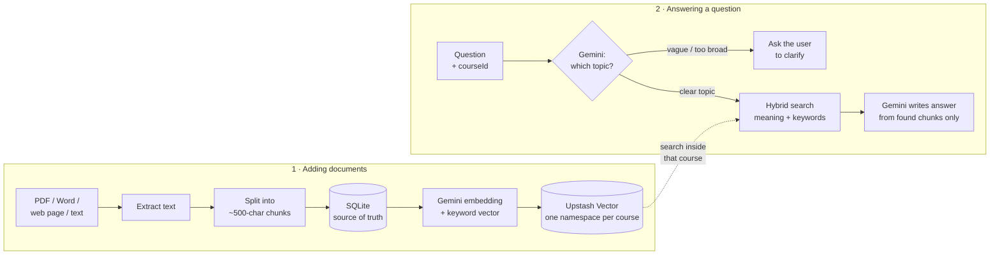
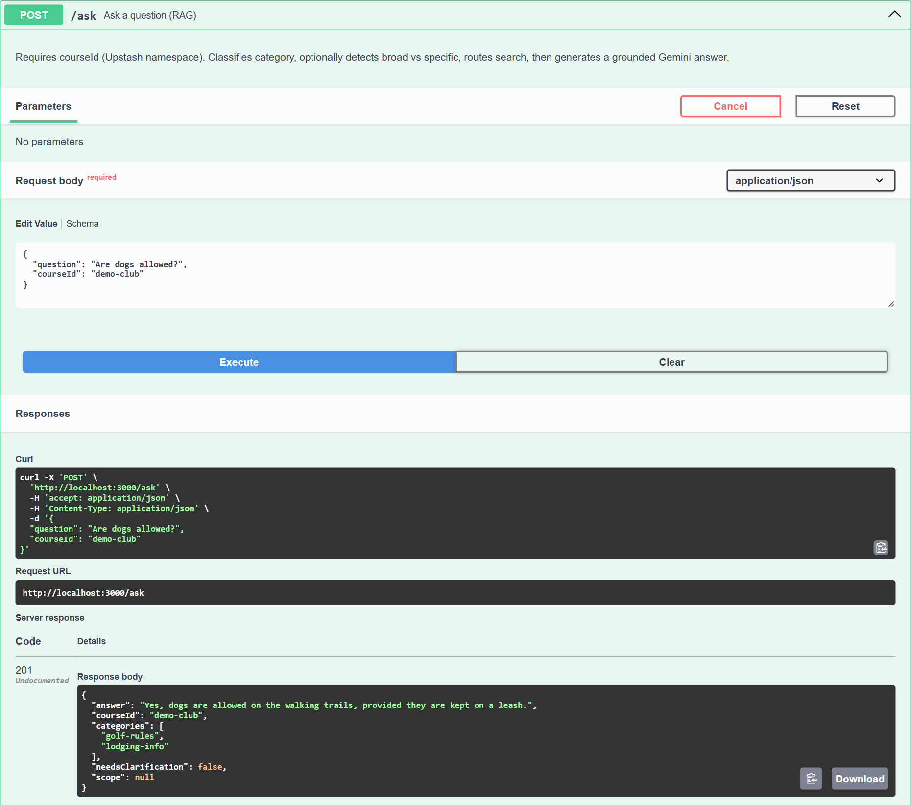

# RAG Knowledge-Base API (NestJS)

A backend that answers questions using **only** a business's own documents.
Upload PDFs, Word files, web pages or plain text; ask a question; get an answer grounded in those documents.

Built during my internship at **Nanonino** and shared with their permission. Client data, keys and client-specific code have been removed.

## How it works



1. **Ingest** — text is extracted (pdf-parse, mammoth, Readability), split into ~500-character chunks and saved to SQLite (the source of truth).
2. **Index** — each chunk gets a dense Gemini embedding plus a sparse keyword vector, stored in an Upstash Vector **hybrid** index. Each course/customer gets its own namespace, so data never mixes.
3. **Route** — Gemini classifies the question into a fixed set of topics (`golf-rules`, `lodging-info`, `events-info`, `contact-info`, `real-estate-info`), using a short description of each. If no topic fits, the whole course is searched instead; the user is only asked to clarify when nothing relevant is found (or for greetings like "hi").
4. **Retrieve** — hybrid search (semantic + keyword, merged with Reciprocal Rank Fusion) inside the course namespace, filtered by topic.
5. **Answer** — Gemini writes an answer using only the retrieved chunks, or says it doesn't know.

## Screenshots

**Asking a question** — a vague question still gets a grounded answer from the ingested documents:



**All endpoints** (interactive Swagger UI at `/api`):


## Tech stack

| Piece | Role |
|---|---|
| **NestJS / TypeScript** | REST API and app structure |
| **SQLite + TypeORM** | Stores chunks, course id, category, titles |
| **Upstash Vector (Hybrid)** | Dense + sparse search, one namespace per course |
| **Google Gemini** | `gemini-embedding-001` embeddings; flash-lite model for routing and answers |
| **pdf-parse, mammoth, @mozilla/readability, jsdom** | Text extraction from PDF, DOCX and web pages |
| **Model Context Protocol (MCP)** | Exposes the Q&A as a tool for AI clients (stdio + Streamable HTTP) |
| **Swagger** | Interactive API docs at `/api` |
| **Zod** | Request and environment validation |

## Setup

### 1. Create an Upstash Vector index

In the [Upstash console](https://console.upstash.com), create a **Vector** index with:

- **Type:** Hybrid
- **Dense dimension:** `1536` (must match `EMBEDDING_DIMENSION`)
- **Similarity:** Cosine
- **Dense embedding model:** none (embeddings are sent by the app)
- **Sparse model:** optional — the app builds its own sparse vectors

Copy the REST URL and token.

### 2. Configure environment

```bash
cp .env.example .env
```

Fill in `GEMINI_API_KEY`, `UPSTASH_VECTOR_REST_URL` and `UPSTASH_VECTOR_REST_TOKEN`.

### 3. Install and run

```bash
npm install
npm run start:dev
```

API: `http://localhost:3000` · Swagger UI: `http://localhost:3000/api`

## Usage

`courseId` (lowercase `a-z0-9_-`) and `category` are required on ingest. Imported files are deleted after a successful import.

```bash
# Import a document
curl -X POST http://localhost:3000/rules/import \
  -F "courseId=demo-club" \
  -F "category=golf-rules" \
  -F "file=@path/to/rules.pdf"

# Add pasted text
curl -X POST http://localhost:3000/kb/text \
  -H "Content-Type: application/json" \
  -d '{"text":"Carts must stay on paths when the course is wet.","courseId":"demo-club","category":"golf-rules"}'

# Queue web pages (background job; poll GET /kb/link/status)
curl -X POST http://localhost:3000/kb/link \
  -H "Content-Type: application/json" \
  -d '{"urls":["https://example.com/club-rules"],"courseId":"demo-club","category":"golf-rules"}'

# Ask a question
curl -X POST http://localhost:3000/ask \
  -H "Content-Type: application/json" \
  -d '{"question":"Can I take a cart out when the course is wet?","courseId":"demo-club"}'

# Rebuild one course's vectors from SQLite
curl -X POST http://localhost:3000/reindex \
  -H "Content-Type: application/json" \
  -d '{"courseId":"demo-club"}'
```

Other endpoints: `GET/POST/PUT/DELETE /rules`, `GET /rules/courses`, `GET /health`.

## MCP

- **HTTP:** mounted at `/mcp` on the same server (Streamable HTTP).
- **stdio:** `npm run start:mcp`

The tool `information_query` takes `question` and `courseId`.

## Known limitations

- No authentication — do not expose publicly without adding an auth guard and rate limiting.
- `POST/PUT/DELETE /rules` update SQLite only; run `/reindex` afterwards to sync vectors.
- Fixed-size character chunking; section-aware chunking would improve retrieval on structured documents.
